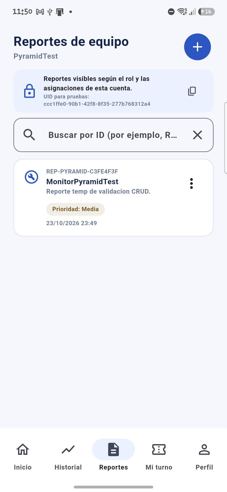
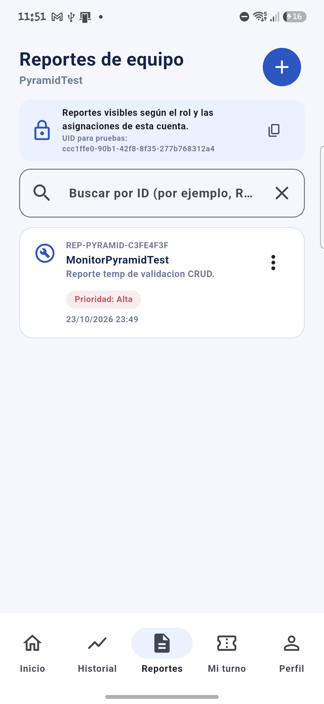
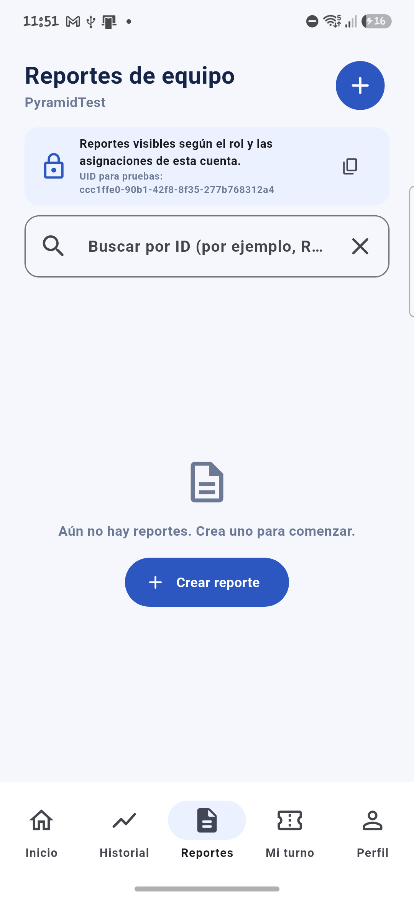

# Pruebas Pyramid Testing — BioMedica

**Proyecto:** BioMedica (Flutter + API Node.js/Express)  
**Funcionalidad crítica:** crear, consultar, editar y eliminar reportes de equipo médico.  
**Fecha de ejecución:** 23 de octubre de 2026  
**Datos:** sintéticos; no se usan datos de pacientes reales.

## 1. Diagnóstico de la estrategia actual

La función elegida permite registrar un reporte con equipo, descripción, prioridad e ID opcional. La app valida los campos, envía operaciones a la API con una sesión autenticada y muestra la lista resultante. La API aplica autenticación, autorización, validación y acceso a Firestore.

Inventario de pruebas local: **64 casos automatizados**, según los resultados actuales de `flutter test` y `npm test`.

| Nivel | Casos | Porcentaje | Evidencia existente |
|---|---:|---:|---|
| Unitarias | 30 | 46.9 % | Validación de reportes, modelos, perfiles, mediciones, BLE y funciones de la API. |
| Integración | 33 | 51.6 % | Widgets, cliente HTTP contra servidor local y API Express con adaptadores de prueba. |
| E2E API automatizada | 1 | 1.6 % | Alta → consulta → edición → eliminación de reporte por HTTP; no recorre la interfaz Flutter. |
| **Total automatizado** | **64** | **100 %** | Conteos confirmados por `flutter test` (52) y `npm test` (12); el redondeo puede sumar 100.1 %. |

La suite Flutter reportó 52 pruebas y la suite Node 12. El flujo E2E móvil descrito abajo es una ejecución manual asistida por ADB y se contabiliza aparte; no forma parte de las 64 pruebas automatizadas del repositorio.

**Ejecución automática detectada:** el backend expone `npm test` (`node --test`) y ejecuta automáticamente los archivos `backend/test/*.test.js`. Flutter usa `flutter test`; el proyecto no declara un script propio ni se encontró un workflow de CI en `.github/workflows`. Se ejecutó Flutter 3.44.2 / Dart 3.12.2 desde el SDK configurado en `android/local.properties`.

## 2. Validación de la base: pruebas unitarias

La lógica de negocio cubre los tres tipos solicitados:

| Caso | Entrada | Resultado esperado |
|---|---|---|
| Válido | Equipo, descripción y prioridad admitidos; longitudes máximas incluyentes. | Validación sin error. |
| Límite | ID de 100 caracteres, equipo de 100 y descripción de 500. | Aceptación en el límite. |
| Inválido | Campos obligatorios vacíos, ID con `/`, longitudes excedidas o prioridad no admitida. | Mensaje de validación/error; no se inicia escritura. |

**Código:** [health_report_validation_test.dart](./test/health_report_validation_test.dart).  
También hay comprobaciones de validación de la API en [api.test.js](./backend/test/api.test.js).

**Resultado observado:** `flutter test` aprobó **52 pruebas ejecutadas, 0 fallidas**. `flutter analyze` terminó con **No issues found**. Las pruebas unitarias del backend también pasaron dentro de la suite automatizada.

## 3. Validación de conexiones: integración

Se agregaron dos pruebas HTTP para ejercitar la API real, el middleware JWT, las rutas Express, la validación y el intercambio de datos con un adaptador de almacenamiento en memoria:

1. Paciente autenticado crea un reporte, lo consulta, lo edita y lo elimina; se verifican respuestas HTTP y cambios observables en la lista/almacenamiento.
2. Se rechazan un reporte inválido y una consulta sin autenticar; el reporte inválido no se persiste.

**Código:** [reports.test.js](./backend/test/reports.test.js).  
**Configuración:** Node.js 22.22.0, npm 10.9.4; comando `npm test --prefix .\backend`.  
**Datos sintéticos:** `report-flow@example.com`, `report-errors@example.com`, reporte `REP-TEST-001` y descripciones ficticias.

La integración HTTP, autenticación y lógica de aplicación son reales; PostgreSQL y Firestore se reemplazan por adaptadores en memoria en estas pruebas. Por ello, esas pruebas automatizadas no demuestran por sí solas persistencia en servicios reales. La validación en dispositivo de la siguiente sección sí ejercita la API desplegada y el almacenamiento Firestore real con datos sintéticos.

**Ejecución:** 12 pruebas aprobadas, 0 fallidas, código de salida 0. `flutter test` reportó 52 pruebas aprobadas. Ambos comandos terminaron con código de salida 0.

```text
> npm test --prefix .\backend
1..12
# tests 12
# pass 12
# fail 0
# skipped 0
# todo 0
```

## 4. Validación E2E

Hay un recorrido E2E automatizado **a nivel de API** en [reports.test.js](./backend/test/reports.test.js): autenticación → alta → consulta → edición → baja. Usa almacenamiento en memoria y no recorre la interfaz móvil.

**E2E móvil ejecutada en dispositivo real (manual/ADB, no automatizada como suite):** Samsung Galaxy A55 (`SM-A556E`, Android 16; ADB `RZCX312D5PN`) con la app Flutter conectada a `https://app-biomedica-web.onrender.com`. El endpoint `/health` respondió HTTP 200. Se creó e inició sesión con una cuenta paciente sintética; en **Reportes de equipo** se verificó la lista vacía, se creó un reporte temporal con equipo y descripción ficticios, se confirmó su aparición, se cambió la prioridad de **Media** a **Alta** y se verificó el valor sincronizado; finalmente se eliminó y se comprobó que la lista volvió a quedar vacía. El recorrido ejercitó la interfaz, la API desplegada y Firestore real, sin usar datos de pacientes ni alterar reportes existentes.

**Evidencia del mismo reporte sintético `REP-PYRAMID-C3FE4F3F`:**





La captura [01_reportes_api_no_configurada.png](./practica_pyramid_evidencias/01_reportes_api_no_configurada.png) conserva el bloqueo inicial ya resuelto y no representa el resultado final.

**Datos y limpieza:** se usaron únicamente valores sintéticos. El reporte temporal fue eliminado y se verificó que ya no aparecía. La cuenta paciente ficticia permanece en PostgreSQL porque la API no ofrece un endpoint de borrado de usuarios; no se guardaron credenciales en el informe.

**Limitación:** no existe una suite `integration_test/` que automatice este flujo móvil de forma repetible en CI. La ejecución manual en el dispositivo acredita el recorrido de esta sesión, pero debe complementarse con una prueba automatizada contra servicios aislados antes de considerarlo una regresión automatizada.

## 5. Auditoría y conclusión técnica

La capa más débil es la **automatización E2E móvil**: el CRUD real ya se validó de punta a punta en el teléfono contra la API desplegada y Firestore, pero el recorrido se hizo manualmente con ADB y no se puede repetir automáticamente en CI. Las pruebas automatizadas de integración usan adaptadores en memoria, por lo que no sustituyen pruebas contra infraestructura aislada. Las 52 pruebas Flutter y las 12 pruebas backend pasaron; `flutter analyze` no reportó incidencias en la validación anterior. No se generó un reporte de cobertura de líneas o ramas; los porcentajes indicados distribuyen casos de prueba.

### Mejoras priorizadas por riesgo

1. **Riesgo alto — automatizar el recorrido móvil de reporte.** Añadir `integration_test` para crear, consultar, editar y eliminar desde la app contra un backend de pruebas; conservar evidencia de ejecución y limpieza de datos.
2. **Riesgo alto — verificar persistencia/autorización contra servicios aislados.** Incorporar Firestore Emulator y PostgreSQL de prueba (por ejemplo, en CI), probar que un paciente no vea/edite datos ajenos y que los cambios sobrevivan a una nueva sesión.

### Qué ejecutar en cada cambio y antes de entregar

| Momento | Pruebas |
|---|---|
| Cada cambio | Unitarias del módulo afectado; análisis/lints; pruebas de widget si cambia interfaz; `npm test --prefix .\backend` si cambia API, autenticación o persistencia. |
| Antes de entregar | Suite Flutter completa con `flutter test`, suite backend, integración contra infraestructura aislada y recorrido E2E móvil; revisar cobertura y adjuntar salida/captura. |

### Veredicto de ejecución

```text
environment:
  docker: UNAVAILABLE — Docker CLI presente; `docker info` falló porque el daemon no responde.
  node: AVAILABLE — v22.22.0.
  flutter: AVAILABLE — Flutter 3.44.2; `flutter test`: exit_code 0, 52 passed; `flutter analyze`: sin incidencias.
  android-device: AVAILABLE — Samsung Galaxy A55, Android 16, ADB `RZCX312D5PN`.
  api-health: PASS — `GET https://app-biomedica-web.onrender.com/health` respondió HTTP 200.
integration: PASS — exit_code: 0; backend 12/12 y Flutter 52/52; pruebas automatizadas locales con adaptadores de prueba. El CRUD móvil también confirmó escritura y lectura en API/Firestore desplegados.
e2e: PASS WITH LIMITATION — flujo HTTP automatizado aprobado y flujo CRUD móvil completo observado en el Samsung; este último fue manual/ADB, no una suite E2E móvil repetible.
overall: PASS — los tres niveles se validaron; queda como mejora prioritaria automatizar el recorrido móvil y ejecutarlo contra infraestructura aislada.
```
